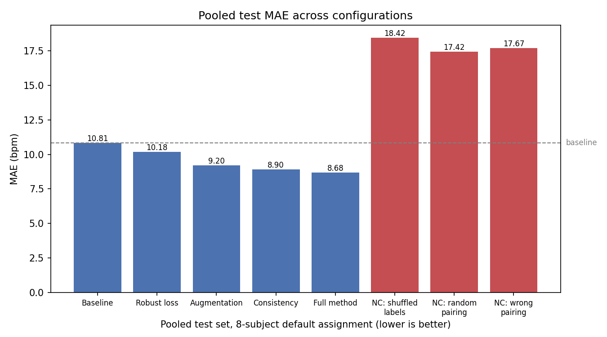
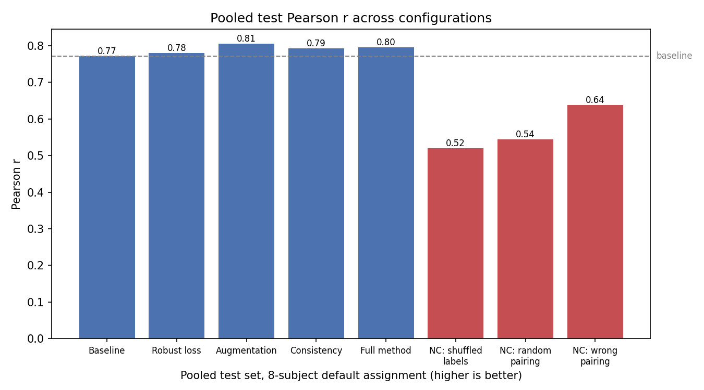

# Report: Custom Training Methodologies for PPG-Based Heart-Rate Estimation

## 1. Objective

The deliverable of this project is a training methodology, not a trained model. A
small 1D CNN is used throughout purely as the instrument for measuring whether three
custom training-time mechanisms — a hand-written robust (Huber-style) loss, data
augmentation, and a paired-consistency training scheme — produce a genuine,
attributable effect on heart-rate estimation from wrist PPG, as opposed to an
artifact of extra computation, data leakage, or chance. Every configuration below
shares the same model architecture, data windows, and evaluation code; only the loss
function and/or batch construction differ between configs.

Maximizing accuracy was explicitly **not** the goal. See Section 6 for an honest
account of this project's limitations.

## 2. Data and method (brief)

- **Dataset**: [PPG-DaLiA](https://archive.ics.uci.edu/dataset/495/ppg+dalia), 8
  subjects (S1-S8). Input: wrist PPG (64 Hz). Target: heart rate, provided every 2 s
  from an 8 s chest-ECG window. Each training window is the matching 8 s of PPG
  ending at the same instant as its label, so no future information leaks into a
  window; windows are z-score normalized per-window before any splitting.
- **Model**: a small 1D CNN (3 conv blocks, BatchNorm, ReLU, max-pooling, then
  adaptive average pooling and a small MLP head), identical across every config.
- **Primary split**: subject-level. Default assignment: S1-S4 train, S5 validation,
  S6-S8 test. No window from a validation/test subject's recording ever appears in
  training.
- **Training mechanisms** (see `src/lossfunction_project/losses/` and
  `src/lossfunction_project/training/`):
  - *Robust loss*: Huber-style, quadratic below `delta=1.0` (in standardized-target
    units), linear above it, so a handful of large-residual training windows cannot
    dominate the gradient the way they would under plain MSE.
  - *Augmentation*: additive Gaussian noise, amplitude scaling, baseline offset, and
    sample dropout, applied to build a paired view x' of each training window (label
    unchanged).
  - *Consistency term*: `L = L_reg(f(x), y) + lambda * L_consistency(f(x), f(x'))`,
    with `L_consistency` the mean squared difference between the two predictions
    (`lambda=0.5`, not tuned). An "augmentation-only" ablation instead adds x' as
    ordinary extra supervised training data, with no consistency term, to separate
    "more/varied data" from "consistency regularization" as possible explanations.

## 3. Ablation results (primary comparison, 8-subject default assignment)

| Config | Train MAE | Val MAE | Test MAE | Test RMSE | Test r |
|---|---|---|---|---|---|
| Baseline (standard loss) | 6.80 | 15.80 | 10.81 | 16.48 | 0.772 |
| Robust loss only | 5.60 | 17.15 | 10.18 | 16.20 | 0.780 |
| Augmentation only | 5.40 | 15.88 | 9.20 | 14.84 | 0.805 |
| Consistency only | 4.28 | 16.44 | 8.90 | 15.10 | 0.793 |
| **Full method** (robust + augmentation + consistency) | 4.20 | 17.17 | **8.68** | 14.89 | 0.796 |

Under this assignment, every active training mechanism improves pooled test MAE
over the baseline, with the full method best overall. Validation MAE is flat and
uninformative across all 5 configs (15.8-17.2) because the validation subject (S5)
is itself an outlier relative to the training subjects (see Section 6) — this makes
best-epoch selection noisier than it would be with a more representative validation
subject, a limitation discussed further below.

**This result does not fully replicate under different subject assignments** —
see Section 5.

## 4. Negative controls

| Control | Train MAE | Test MAE | Test r |
|---|---|---|---|
| Shuffled training labels | 12.12 | 18.42 | 0.520 |
| Random pairing (x paired with an unrelated window) | 10.75 | 17.42 | 0.544 |
| Wrong pairing (fixed, deterministic mismatch) | 11.30 | 17.67 | 0.638 |

All three negative controls perform the *same* extra forward/backward pass per
batch as the full method, yet land not just below the full method but **clearly
above (worse than) the plain baseline** on both train and test MAE. This is the key
evidence that the full method's improvement in Section 3 is not an artifact of
extra computation: corrupting either the label or the pairing does not merely erase
the benefit, it actively degrades training, consistent with the consistency term
pushing the model to agree on predictions that have no reason to agree when x and
x' come from genuinely different underlying signals.

Severity does not differentiate meaningfully between the three negative controls
(17.4-18.4 MAE, within about 1 unit of each other); with one run per control, a
finer ranking between them is not considered reliable.

## 5. Subject-assignment sensitivity check

The same `baseline` and `full_method` configs were re-run under two additional
subject-role assignments, obtained by a purely mechanical circular shift of
S1-S8 (not chosen based on subject profiles or outcomes).

| Assignment | Test subjects | Baseline test MAE / r | Full method test MAE / r | MAE winner |
|---|---|---|---|---|
| Default | S6 (outlier), S7, S8 | 10.81 / 0.772 | 8.68 / 0.796 | Full method |
| Reshuffle 1 | S1, S2, S8 (all typical) | 8.59 / 0.707 | 9.61 / 0.716 | Baseline |
| Reshuffle 2 | S2, S3, S4 (all typical) | 7.38 / 0.738 | 7.72 / 0.755 | Baseline |

**This is the single most important finding of this project.** The full method's
MAE advantage in Section 3 only appears when the test set includes the outlier
subject S6 (see Section 6). Under both reshuffles — whose test sets happen, as a
side effect of the mechanical shift, to consist entirely of typical subjects — the
baseline actually has the *lower* test MAE. The headline ablation result is
therefore not a general, assignment-independent property of the method; it is at
least partly specific to this one subject composition.

A smaller, more consistent pattern: the full method's test Pearson r is slightly
higher than the baseline's in all three assignments (0.796 vs. 0.772, 0.716 vs.
0.707, 0.755 vs. 0.738). A plausible (not independently confirmed) interpretation
is that the method shifts *where* errors land — fewer large errors on hard cases —
without necessarily lowering typical-case error, which would show up as improved
correlation without improved MAE.

A seed-variability check (same configs and assignment, a second random seed) showed
a similar pattern: the baseline-vs-any-active-method gap was consistent, but the
fine-grained ranking *among* the four active-method configs (robust/augmentation/
consistency/full) was not stable across seeds. With only two seeds, this ranking
instability should be read as "not yet resolved," not "there is no effect."

## 6. Window-level leakage comparison

| Config | Test MAE | Test r |
|---|---|---|
| Baseline, window-level split | 5.49 | 0.943 |
| Full method, window-level split | 5.49 | 0.935 |

The window-level split pools windows from all subjects and shuffles them before
splitting, ignoring subject identity. Because consecutive windows overlap 75%
(8 s windows, 2 s shift), near-duplicate windows land on both sides of the split.
The result: pooled test MAE drops to ~5.5 for *both* configs (vs. 7.4-10.8 under
any proper subject-level assignment), and the method effect is completely
swamped — the two configs become statistically indistinguishable. This is included
specifically to illustrate why window-level splitting is unsafe for this kind of
physiological-signal data, not as a recommended evaluation protocol.

## 7. Limitations

- **Small subject count.** 8 subjects total, 3-4 per role. Any single-assignment
  result should be treated as anecdotal; Section 5 exists specifically because of
  this, and still leaves the fine method-ranking question open.
- **One identified outlier subject (S6).** S6's heart-rate range (mean 119.5,
  max 174.3 bpm) lies almost entirely outside the training subjects' typical range,
  and every configuration — baseline, every ablation, and the full method — fails
  on it in a similar way (MAE 13.7-16.0 across all 5 configs in Section 3). No
  training-time method tested here fixes this: the failure is a subject-level
  distribution shift (the model has no training signal anywhere near S6's heart-rate
  range), not within-distribution noise, and a loss-function or augmentation change
  cannot manufacture information about a regime never observed in training. This was
  also observed, independently, for a second atypical subject (S5) when it played
  the test role in an earlier, 5-subject version of this pipeline.
- **Ranking among active methods is not stable.** Section 5 shows that which
  specific active method (robust loss, augmentation, consistency, or the full
  combination) performs best depends on both subject assignment and random seed.
  Only the broader claim — active methods beat the standard-loss baseline, and
  negative controls perform worse than baseline — is considered well-evidenced.
- **Noisy best-epoch selection.** Validation MAE curves were sometimes erratic
  (e.g. a single favorable epoch surrounded by much worse ones), especially when
  the validation subject was itself atypical. Best-epoch selection by validation
  MAE can therefore pick a somewhat lucky checkpoint rather than a stable optimum.
- **Hyperparameters were not tuned.** `delta=1.0` (robust loss) and `lambda=0.5`
  (consistency weight) were reasoned defaults, not the result of a search; a
  different choice could change the magnitude (though probably not the qualitative
  pattern) of the results above.
- **Single model architecture, single dataset.** All results are specific to this
  1D CNN and to PPG-DaLiA; they should not be assumed to transfer to other
  architectures or physiological-signal datasets without re-verification.

## 8. Conclusion

The negative controls and the window-level leakage comparison give clear, credible
evidence for two things: the observed training-time method effects are not an
artifact of extra computation, and a careless (window-level) evaluation protocol
can make a real effect invisible or fabricate an inflated one. Those are the most
trustworthy findings in this report.

The headline ablation result — a monotonic improvement from baseline to the full
method — is real under the default subject assignment, but the subject-assignment
sensitivity check shows this specific ranking is not a stable, assignment-independent
property of the method. The more defensible, general claim is narrower: some
form of active training-time intervention (robust loss, augmentation, or
consistency) tends to beat plain standard-loss training on typical subjects, and a
small but consistent gain in prediction-target correlation (Pearson r) appears
regardless of subject composition. Which specific mechanism is "best," and by how
much, remains an open question given the scale of this project — and is reported
as such rather than overstated.
